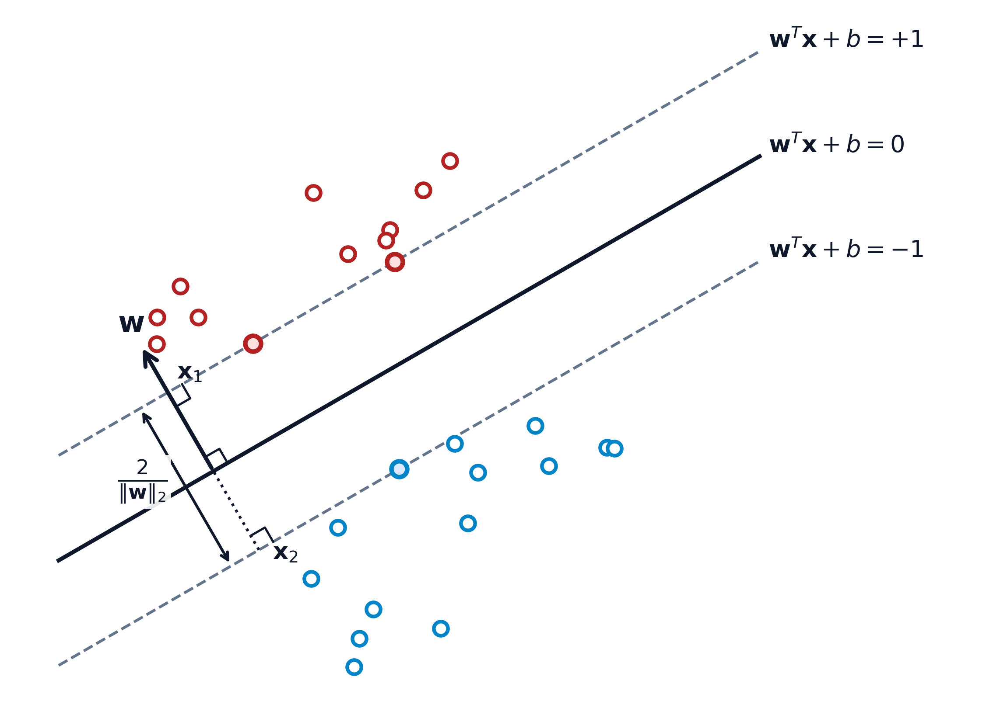

# Planteamiento del problema de clasificación

Dado un conjunto de aprendizaje $\mathcal{L} =\{(\mathbf{x_i}, y_i): i = 1,2, \ldots, n\}$, linealmente separable, sobre el par $(\mathbf{X}, Y)$ donde $\mathbf{X} \in \mathbb{R}^r$ e $Y\in \{-1,1\}$. Queremos encontrar el hiperplano de la forma: 

$$\{x: f(x) = \mathbf{w}^T\mathbf{x} + b=0\}$$


dond $\mathbf{w}$ es el vector de pesos, y $b$ es el sesgo del hiperplano. Sin embargo, en un problema de clasificación, queremos que los puntos en una clase (digamos la clase +1) satisfagan:


$$\mathbf{w}^T\mathbf{x} + b \geq +1$$


mientras que los puntos en la otra clase (la clase -1) satisfagan:


$$\mathbf{w}^T\mathbf{x} + b \leq -1$$


# Hiperplano de margen máximo

La distancia entre el hiperplano y el punto más cercano de cada clase es conocida como el margen. En la imagen, el margen es la distancia entre estas dos líneas punteadas. El objetivo es maximizar este margen para aumentar la confianza en la clasificación y reducir el riesgo de errores de clasificación con nuevos datos. Para ello calcularemos el hiperplano que maximice ese margen.


{#fig-margen-maximo fig-align="center" width="75%"}

# Formulación del problema de optimización

Para maximizar el margen, queremos minimizar $||w||$. ¿Por qué? Porque el margen $M$ es inversamente proporcional a $||w||$ , esto es:

$$M = \frac{2}{||w||}$$


Minimizar $||w||$ es equivalente a minimizar $\frac{||w||^2}{2}$, que es una forma más sencilla de trabajar la función en el problema de optimización, y el factor $\frac{1}{2}$ es solo para simplificar el cálculo posterión al diferenciar.
 
El problema de optimización que proporciona el hiperplano de máxima separación es:


$$
\begin{aligned}
& \underset{\mathbf{w}}{\text{minimizar}}
& &  \frac{1}{2} ||w||^2_2\\
& \text{sujeto a}
& & y_i(\mathbf{w}^T\mathbf{x} + b) \geq 1 \\
& & &  i = 1, \ldots, n
\end{aligned}
$$


## Importancia de la restricción

En el contexto del hiperplano de margen duro, la restricción de que $y_i(\mathbf{w}^T \mathbf{x}_i + b) \geq 1$ juega un papel crucial en la clasificación y la maximización del margen. Aquí explicamos el porqué:

1. **Margen de Separación**: El objetivo principal es encontrar un hiperplano que no solo separe las dos clases, sino que también maximice el margen, es decir, la distancia mínima entre el hiperplano y los puntos más cercanos de cada clase.

2. **Escala del Margen**: La restricción asegura que el punto más cercano de cada clase esté, como mínimo, a una distancia unitaria del hiperplano. Esto se logra escalando el margen en términos de la norma del vector $\mathbf{w}$. Matemáticamente, la distancia de un punto $\mathbf{x}_i$ al hiperplano se calcula como $d = \frac{|\mathbf{w}^T \mathbf{x}_i + b|}{||\mathbf{w}||}$, y la restricción mencionada estandariza esta distancia a un mínimo de 1.

3. **Clasificación Correcta**: Las etiquetas $y_i$ son +1 o -1 para cada clase. Esta restricción garantiza que todos los puntos estén clasificados correctamente, asegurando que estén en el lado correcto del hiperplano. Para puntos de la clase +1, se convierte en $\mathbf{w}^T \mathbf{x}_i + b \geq 1$, y para la clase -1 en $\mathbf{w}^T \mathbf{x}_i + b \leq -1$.

4. **Maximización del Margen**: Al satisfacer estas restricciones y minimizar $\frac{1}{2} ||\mathbf{w}||^2$, que es la función objetivo, se maximiza el margen entre las dos clases. Esta restricción es una forma estandarizada de definir el margen en todos los hiperplanos, facilitando cálculos y comparaciones consistentes.

En resumen, la restricción $y_i(\mathbf{w}^T \mathbf{x}_i + b) \geq 1$ es esencial para asegurar la clasificación correcta y la maximización del margen.


## Análisis de convexidad

El problema es un problema convexo. Para entender por qué, primero debemos desglosar los componentes del problema y ver cómo se relacionan con la convexidad:

1. **Función Objetivo**: La función objetivo es $\frac{1}{2} ||w||^2_2$, una función cuadrática y específicamente una norma cuadrada. Esta es conocida por ser una función convexa, ya que su segunda derivada es constante y positiva.

2. **Restricciones**: Las restricciones son de la forma $y_i(\mathbf{w}^T\mathbf{x}_i + b) \geq 1$ para $i = 1, \ldots, n$. Estas son restricciones lineales. Las restricciones lineales también son convexas, ya que el conjunto de soluciones que satisfacen una desigualdad lineal forma un espacio convexo.

Dado que tanto la función objetivo como las restricciones son convexas, el problema en su conjunto es un problema de optimización convexa.

# Ejemplo de resolución

## Importar librerías necesarias

Primero, importamos las librerías necesarias para nuestro proyecto:

- `cvxpy` para la optimización.
- `numpy` para manejar operaciones matemáticas y estructuras de datos.
- `matplotlib` para la visualización.

Estas herramientas nos permitirán definir y resolver problemas de optimización convexa y visualizar nuestros datos y resultados.

```{python}
import cvxpy as cp
import numpy as np
import matplotlib.pyplot as plt
```

## Generar datos simulados

Generamos un conjunto de datos linealmente separables. Utilizamos `numpy` para crear dos grupos de puntos clasificados como +1 y -1. Estos grupos se visualizan para confirmar su separabilidad.

El proceso es como sigue:

1. Generamos puntos aleatorios.
2. Creamos dos grupos basados en una función lineal.
3. Visualizamos los puntos para confirmar que son linealmente separables.

```{python}
np.random.seed(0)
x = np.random.randn(100, 2)
y_mask = 4*x[:, 0] + 5 > x[:, 1]

x_pos = np.column_stack((x[y_mask, 0], x[y_mask, 1]))
x_neg = np.column_stack((x[~y_mask, 0] - 1, x[~y_mask, 1]))

X = np.vstack((x_neg, x_pos))
y = np.sort(y_mask.astype(int)*2-1)

# Visualización de los datos
plt.figure(figsize=(8, 6))
plt.scatter(x_pos[:, 0], x_pos[:, 1], label='Clase +1')
plt.scatter(x_neg[:, 0], x_neg[:, 1], label='Clase -1')
plt.title('Conjunto de Datos Linealmente Separable')
plt.legend()
plt.show()
```

## Definir variables de optimización

Definimos las variables de optimización `w` (pesos) y `b` (sesgo) usando `cvxpy`. Estas variables se ajustarán para encontrar el hiperplano de máxima separación.

- `w`: Vector de pesos.
- `b`: Término de sesgo.

```{python}
import cvxpy as cp
m, n = X.shape
w = cp.Variable(n)
b = cp.Variable()
```

## Establecer el objetivo de optimización

El objetivo es minimizar la norma (longitud) del vector de pesos `w`, que se representa matemáticamente como:


$$\underset{\mathbf{w}}{\text{minimizar}} \quad \frac{1}{2} ||\mathbf{w}||_2^2$$


Este objetivo ayuda a encontrar un hiperplano que maximice la separación entre las dos clases.


**Nota**: La norma 2 de un vector `w`, denotada como $||\mathbf{w}||_2$, se refiere a la norma euclidiana, que es la longitud del vector en el espacio euclidiano. Se calcula como la raíz cuadrada de la suma de los cuadrados de sus componentes, es decir, $||\mathbf{w}||_2 = \sqrt{w_1^2 + w_2^2 + \ldots + w_n^2}$.

```{python}
import cvxpy as cp
objective = cp.Minimize(0.5 * cp.norm(w, 2))
```

## Definir las restricciones

Las restricciones garantizan que todas las muestras de cada clase estén en el lado correcto del hiperplano. Para cada punto de datos $\mathbf{x}_i$ con etiqueta $y_i$, la restricción se define como:


$$y_i (\mathbf{w}^T \mathbf{x}_i + b) \geq 1, \quad \text{para todo } i$$


Esto asegura que el producto escalar entre `w` y cada muestra `x`, ajustado por `b`, sea adecuado para la clasificación correcta.

```{python}
import cvxpy as cp
constraints = [cp.multiply(y, X @ w + b) >= 1]
```

# Resolver el problema de optimización

Creamos y resolvemos el problema de optimización utilizando las variables, el objetivo y las restricciones definidas. Esto nos permitirá encontrar los valores óptimos de `w` y `b`.

Al resolver este problema, CVXPY automáticamente encuentra la solución que minimiza nuestro objetivo y satisface las restricciones.

```{python}
import cvxpy as cp
prob = cp.Problem(objective, constraints)
prob.solve()

print("Valor óptimo de w: ", w.value)
print("Valor óptimo de b: ", b.value)
```

## Visualizar el hiperplano resultante

La ecuación del hiperplano se deriva de la formulación general y se adapta para su visualización en un gráfico bidimensional. A continuación se explica cómo se obtiene esa ecuación:

En este problema, el hiperplano que separa dos clases se define por la ecuación:


$$\mathbf{w}^T \mathbf{x} + b = 0$$


donde:

- $\mathbf{w} = [w_0, w_1]$ es el vector de pesos.
- $\mathbf{x} = [x_1, x_2]$ representa un punto en el espacio de características.
- $b$ es el término de sesgo.

Para visualizar este hiperplano en un espacio bidimensional (por ejemplo, en un gráfico con ejes x e y), reorganizamos la ecuación para despejar una de las variables, generalmente $x_2$ (que podemos considerar como $y$ en el gráfico de dispersión), en función de la otra ($x_1$, que consideramos como $x$ en el gráfico). La ecuación reorganizada nos permite trazar una línea en el gráfico que representa el hiperplano.

Reorganizando la ecuación del hiperplano:


$$\mathbf{w}^T \mathbf{x} + b = w_0 x_1 + w_1 x_2 + b = 0$$


Despejando $x_2$ (o $y$):


$$w_1 x_2 = -w_0 x_1 - b$$


$$x_2 = -\frac{w_0}{w_1} x_1 - \frac{b}{w_1}$$


Por lo tanto, en términos de un gráfico de dispersión con $x$ e $y$:


$$y = -\frac{w_0}{w_1} x - \frac{b}{w_1}$$


Esta es la ecuación que usarías para trazar el hiperplano en un gráfico de dispersión, utilizando los valores óptimos de $w_0$, $w_1$ y $b$ obtenidos de la solución de tu problema de optimización.

```{python}
# Obtener valores de w y b
w_opt = w.value
b_opt = b.value

# Encontrar los límites para el eje y basándose en los datos
y_min, y_max = X[:, 1].min(), X[:, 1].max()

# Crear una figura para la visualización
plt.figure(figsize=(8, 6))

# Graficar los puntos de datos
plt.scatter(x_pos[:, 0], x_pos[:, 1], label='Clase +1')
plt.scatter(x_neg[:, 0], x_neg[:, 1], label='Clase -1')

# Ajustar los valores de x para cubrir los límites verticales
# Se calcula x_values en función de y_values para el hiperplano
y_values = np.linspace(y_min, y_max, 100)
x_values = -(y_values * w_opt[1] + b_opt) / w_opt[0]

# Graficar el hiperplano
plt.plot(x_values, y_values, label='Hiperplano', color='red')

# Configurar leyendas y títulos
plt.title('Hiperplano de Máxima Separación en el Conjunto de Datos')
plt.xlabel('x1')
plt.ylabel('x2')
plt.legend()
plt.show()
```

